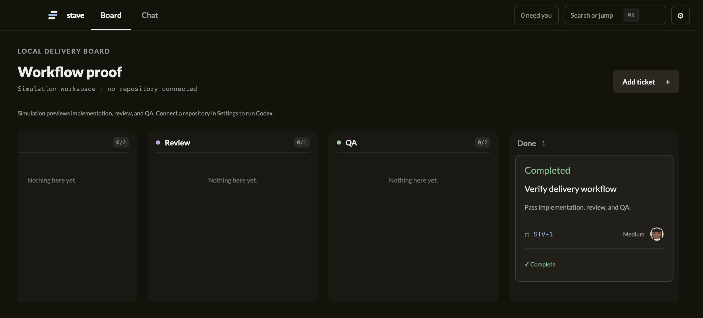
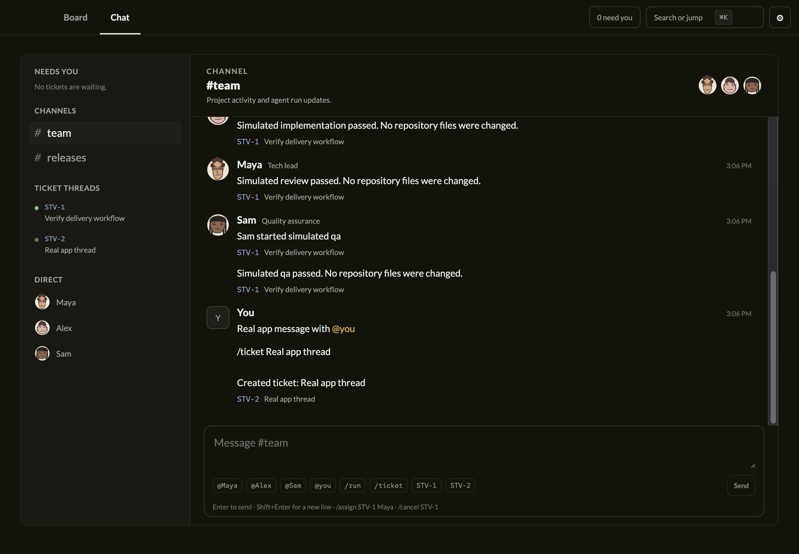

<p align="center">
  
</p>

<h1 align="center">Stave</h1>

<p align="center">
  A local-first delivery board for teams of coding agents.
</p>

<p align="center">
  <a href="https://github.com/boatnoah/stave/actions/workflows/ci.yml"></a>
</p>



Stave is an Electron desktop app. You add tickets to a board, and a small team of role-based agents moves each one from Todo to Done. An engineer implements it, a tech lead reviews it, and a QA agent verifies it. Real runs use your local [Codex CLI](https://github.com/openai/codex) inside an isolated Git worktree for each ticket. Nothing leaves your machine, and Stave never pushes.

> [!NOTE]
> Stave is in early development and has no published release yet.

## Features

- **Delivery board.** Tickets move through Todo, Implementation, Review, QA, and Done. Only a passing QA run marks a ticket Done. Failed, canceled, or blocked runs stay in their stage and can be resumed.
- **Team chat.** A `#team` channel, a thread for each ticket, and direct messages with each agent. Slash commands such as `/ticket`, `/run`, `/assign`, and `/cancel` drive the board from chat.
- **Needs-you queue.** When an agent needs a decision, the ticket waits for your answer and then resumes the same run.
- **Isolated worktrees.** Each ticket gets its own Git branch and worktree. Stave never resets, cleans, or deletes your work.
- **Sandboxed Codex runs.** Codex runs with workspace-write access, no command network access, no web search, and connected tools disabled. Approval requests are denied. See the [Codex runtime spec](docs/specs/codex-runtime.md).
- **Simulation mode.** Without a connected repository, the board runs a clearly labelled simulation that never touches files.
- **Procedural avatars.** Each agent has a stable SVG identity whose expression and motion reflect what it is actually doing.



## Getting started

### Requirements

- Node.js 24 or newer
- pnpm 11
- Git
- The [`codex`](https://github.com/openai/codex) CLI, signed in, to run real tickets. Simulation mode works without it.

### Run the app

```bash
pnpm install
pnpm dev
```

Create a project and optionally point it at a local Git repository. Leave the repository empty to explore in simulation mode. You can connect one later in Settings.

Stave uses your existing `codex` sign-in and configured model. It does not read your credentials or manage login.

## Development

| Task | Command |
| --- | --- |
| Run every CI check | `pnpm verify` |
| Format and apply safe lint fixes | `pnpm lint:fix` |
| Typecheck all packages | `pnpm typecheck` |
| Run unit tests | `pnpm test` |
| Coverage report | `pnpm test:coverage` |
| End-to-end tests (macOS) | `pnpm e2e` |
| Build a local installer | `pnpm --filter @stave/desktop make` |

### Repository layout

```text
apps/desktop/            Electron main process, preload bridge, and React renderer
packages/domain/         Project, team, and workflow vocabulary
packages/avatar/         Browser-safe procedural SVG avatars
packages/db/             SQLite workspace store
packages/git-workspace/  Isolated Git worktrees per ticket
packages/agent-runtime/  Codex app-server adapter
docs/specs/              Behaviour specs, one per feature
docs/adr/                Architecture decision records
docs/architecture/       Package boundaries and dependency direction
assets/                  Design references and avatar sources
```

## Documentation

- [Product workflow](docs/specs/product-workflow.md)
- [Codex runtime](docs/specs/codex-runtime.md)
- [Git ticket workspaces](docs/specs/git-workspaces.md)
- [Workspace persistence](docs/specs/persistence.md)
- [Domain model](docs/specs/domain-model.md)
- [UI design](docs/specs/ui-redesign.md)
- [Repository architecture](docs/architecture/repository.md)
- [Releasing](docs/releasing.md)

## Contributing

Commands, layout, and rules for people and coding agents live in [AGENTS.md](AGENTS.md). The pull request flow is in [CONTRIBUTING.md](CONTRIBUTING.md). Report vulnerabilities as described in [SECURITY.md](SECURITY.md).
